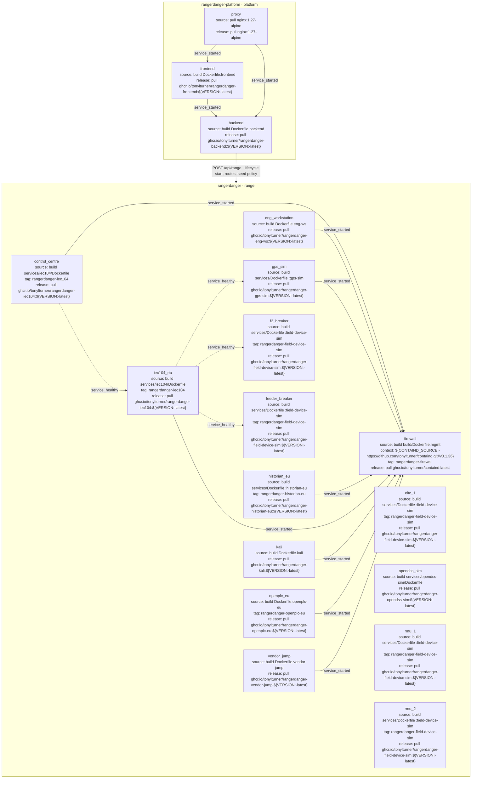
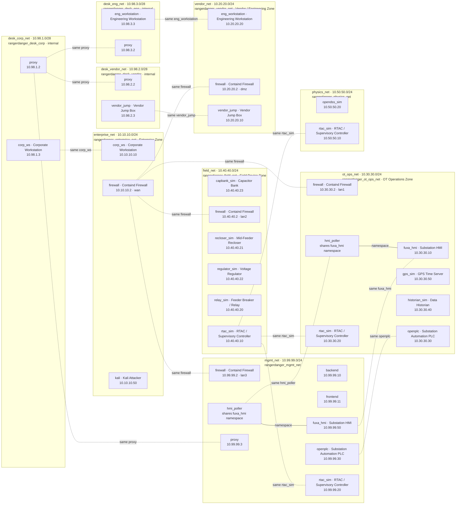

# Docker architecture

How the platform and selected range package are composed: services, image
modes, Docker networks and browser request paths. For the teaching topology
and RTAC routing see [`architecture.md`](architecture.md); for code layout
see [`CONTRIBUTING.md`](../CONTRIBUTING.md).

All six Mermaid regions (including the README overview) are generated by
[`scripts/generate_architecture.py`](../scripts/generate_architecture.py).
Run `python3 scripts/generate_architecture.py` after changing the inputs;
CI runs `python3 scripts/generate_architecture.py --check` and rejects drift.
The generator reads package-declared topology pointers, manifests, source and
release Compose files, platform/package nginx routes, the frontend version
and the release image inventory. It does not run Docker or contact registries.
Non-declarative logical edges live in the small reviewed
[`architecture/overlay.yml`](architecture/overlay.yml), with repository source
citations. A checker verifies citation paths exist, not that their semantics
remain correct; those edges still require code review.

## Compose stack - services, images, dependencies

Each package runs beside the persistent **platform** (`rangerdanger-platform`:
backend, frontend, proxy). The selected **range** is project `rangerdanger`;
US and EU are alternatives, not simultaneous projects. Root Compose files
own the platform; each package owns `compose.source.yml` and
`compose.release.yml`.

Boxes show **source** build/pull declarations separately from **release**
pulls. A service can declare both `build:` and `image:`: the latter names
the build output in source mode. In particular, source mode builds
`rangerdanger-firewall` from the containd git ref in its context (or the
explicit `CONTAIND_SOURCE` override); release mode pulls containd `latest`.
The diagrams describe image preparation, not a promise that the backend
builds images: lifecycle startup uses prebuilt images.

Dependency arrows point from dependent to prerequisite, and carry the exact
Compose condition. Solid = `service_started`; dashed = `service_healthy`
(or another explicitly named completion condition). These are startup
relationships, **not logical traffic flows**. Namespace links mean one
network namespace, not an additional NIC. The separately cited lifecycle
edge describes backend-managed startup, routes and default policy; there
is no cross-project Compose `depends_on`.

### US package

```mermaid
flowchart TB
    subgraph n_us_platform_9b44174f23["rangerdanger-platform · platform"]
    n_us_compose_backend_498c6eb888["backend<br/>source: build Dockerfile.backend<br/>release: pull ghcr.io/tonylturner/rangerdanger-backend:$#123;VERSION:-latest#125;"]
    n_us_compose_frontend_9a5cb0fe74["frontend<br/>source: build Dockerfile.frontend<br/>release: pull ghcr.io/tonylturner/rangerdanger-frontend:$#123;VERSION:-latest#125;"]
    n_us_compose_proxy_9ad386b7ed["proxy<br/>source: pull nginx:1.27-alpine<br/>release: pull nginx:1.27-alpine"]
    end
    n_us_compose_frontend_9a5cb0fe74 -->|"service_started"| n_us_compose_backend_498c6eb888
    n_us_compose_proxy_9ad386b7ed -->|"service_started"| n_us_compose_backend_498c6eb888
    n_us_compose_proxy_9ad386b7ed -->|"service_started"| n_us_compose_frontend_9a5cb0fe74
    subgraph n_us_range_0321fc2186["rangerdanger · range"]
    n_us_compose_capbank_sim_6f7dab5aef["capbank_sim<br/>source: build services/Dockerfile :capbank-sim<br/>release: pull ghcr.io/tonylturner/rangerdanger-capbank-sim:$#123;VERSION:-latest#125;"]
    n_us_compose_corp_ws_f0398579f9["corp_ws<br/>source: build Dockerfile.corp-ws<br/>release: pull ghcr.io/tonylturner/rangerdanger-corp-ws:$#123;VERSION:-latest#125;"]
    n_us_compose_eng_workstation_56ddebdbe5["eng_workstation<br/>source: build Dockerfile.eng-ws<br/>release: pull ghcr.io/tonylturner/rangerdanger-eng-ws:$#123;VERSION:-latest#125;"]
    n_us_compose_firewall_075662beef["firewall<br/>source: build build/Dockerfile.mgmt<br/>context: $#123;CONTAIND_SOURCE:-https://github.com/tonylturner/containd.git#35;v0.1.36#125;<br/>tag: rangerdanger-firewall<br/>release: pull ghcr.io/tonylturner/containd:latest"]
    n_us_compose_fuxa_hmi_259698b3a3["fuxa_hmi<br/>source: build Dockerfile.fuxa-hmi<br/>tag: rangerdanger-fuxa-hmi<br/>release: pull ghcr.io/tonylturner/rangerdanger-fuxa-hmi:$#123;VERSION:-latest#125;"]
    n_us_compose_gps_sim_f42cfd8c71["gps_sim<br/>source: build services/Dockerfile :gps-sim<br/>release: pull ghcr.io/tonylturner/rangerdanger-gps-sim:$#123;VERSION:-latest#125;"]
    n_us_compose_historian_sim_f4fa42aecb["historian_sim<br/>source: build services/Dockerfile :historian-sim<br/>release: pull ghcr.io/tonylturner/rangerdanger-historian-sim:$#123;VERSION:-latest#125;"]
    n_us_compose_hmi_poller_25adcf9058["hmi_poller<br/>source: pull alpine:3.21<br/>release: pull alpine:3.21"]
    n_us_compose_kali_b891853735["kali<br/>source: build Dockerfile.kali<br/>release: pull ghcr.io/tonylturner/rangerdanger-kali:$#123;VERSION:-latest#125;"]
    n_us_compose_opendss_sim_ab889d201b["opendss_sim<br/>source: build services/opendss-sim/Dockerfile<br/>release: pull ghcr.io/tonylturner/rangerdanger-opendss-sim:$#123;VERSION:-latest#125;"]
    n_us_compose_openplc_9a932f75ee["openplc<br/>source: build Dockerfile.openplc<br/>release: pull ghcr.io/tonylturner/rangerdanger-openplc:$#123;VERSION:-latest#125;"]
    n_us_compose_recloser_sim_b44b66d0ee["recloser_sim<br/>source: build services/Dockerfile :recloser-sim<br/>release: pull ghcr.io/tonylturner/rangerdanger-recloser-sim:$#123;VERSION:-latest#125;"]
    n_us_compose_regulator_sim_258a276a49["regulator_sim<br/>source: build services/Dockerfile :regulator-sim<br/>release: pull ghcr.io/tonylturner/rangerdanger-regulator-sim:$#123;VERSION:-latest#125;"]
    n_us_compose_relay_sim_8b3f5121ef["relay_sim<br/>source: build services/Dockerfile :relay-sim<br/>release: pull ghcr.io/tonylturner/rangerdanger-relay-sim:$#123;VERSION:-latest#125;"]
    n_us_compose_rtac_sim_cea59b9b4b["rtac_sim<br/>source: build services/Dockerfile :rtac-sim<br/>release: pull ghcr.io/tonylturner/rangerdanger-rtac-sim:$#123;VERSION:-latest#125;"]
    n_us_compose_vendor_jump_47c8dd627d["vendor_jump<br/>source: build Dockerfile.vendor-jump<br/>release: pull ghcr.io/tonylturner/rangerdanger-vendor-jump:$#123;VERSION:-latest#125;"]
    end
    n_us_compose_capbank_sim_6f7dab5aef -->|"service_started"| n_us_compose_firewall_075662beef
    n_us_compose_corp_ws_f0398579f9 -->|"service_started"| n_us_compose_firewall_075662beef
    n_us_compose_eng_workstation_56ddebdbe5 -->|"service_started"| n_us_compose_firewall_075662beef
    n_us_compose_fuxa_hmi_259698b3a3 -->|"service_started"| n_us_compose_firewall_075662beef
    n_us_compose_gps_sim_f42cfd8c71 -->|"service_started"| n_us_compose_firewall_075662beef
    n_us_compose_historian_sim_f4fa42aecb -->|"service_started"| n_us_compose_firewall_075662beef
    n_us_compose_historian_sim_f4fa42aecb -->|"service_started"| n_us_compose_rtac_sim_cea59b9b4b
    n_us_compose_hmi_poller_25adcf9058 -->|"service_started"| n_us_compose_fuxa_hmi_259698b3a3
    n_us_compose_hmi_poller_25adcf9058 -->|"service_started"| n_us_compose_rtac_sim_cea59b9b4b
    n_us_compose_hmi_poller_25adcf9058 ---|"shares network namespace"| n_us_compose_fuxa_hmi_259698b3a3
    n_us_compose_kali_b891853735 -->|"service_started"| n_us_compose_firewall_075662beef
    n_us_compose_openplc_9a932f75ee -->|"service_started"| n_us_compose_firewall_075662beef
    n_us_compose_recloser_sim_b44b66d0ee -->|"service_started"| n_us_compose_firewall_075662beef
    n_us_compose_regulator_sim_258a276a49 -->|"service_started"| n_us_compose_firewall_075662beef
    n_us_compose_relay_sim_8b3f5121ef -->|"service_started"| n_us_compose_firewall_075662beef
    n_us_compose_rtac_sim_cea59b9b4b -.->|"service_healthy"| n_us_compose_capbank_sim_6f7dab5aef
    n_us_compose_rtac_sim_cea59b9b4b -->|"service_started"| n_us_compose_firewall_075662beef
    n_us_compose_rtac_sim_cea59b9b4b -.->|"service_healthy"| n_us_compose_opendss_sim_ab889d201b
    n_us_compose_rtac_sim_cea59b9b4b -.->|"service_healthy"| n_us_compose_recloser_sim_b44b66d0ee
    n_us_compose_rtac_sim_cea59b9b4b -.->|"service_healthy"| n_us_compose_regulator_sim_258a276a49
    n_us_compose_rtac_sim_cea59b9b4b -.->|"service_healthy"| n_us_compose_relay_sim_8b3f5121ef
    n_us_compose_vendor_jump_47c8dd627d -->|"service_started"| n_us_compose_firewall_075662beef
    %% source: backend/internal/lifecycle/transition.go:157
    n_us_compose_backend_498c6eb888 -.->|"POST /api/range · lifecycle start, routes, seed policy"| n_us_range_0321fc2186
```

<!-- BEGIN GENERATED: compose-us -->


Release inventory: **20 first-party images**, including **9 shared-service targets**.
amd64-only: `rangerdanger-openplc`, `rangerdanger-openplc-eu`.
Source build bases are not the same inventory as upstream service pulls.
<!-- END GENERATED: compose-us -->

### EU package

<!-- BEGIN GENERATED: compose-eu -->

<!-- END GENERATED: compose-eu -->

Upstream **service pulls** appear in the boxes (for example nginx, containd
in release mode, and the US poller). Build-base images are a different
inventory: see the Dockerfiles and image pin gate, not a count of running
services.

## Docker network wiring

These diagrams show complete Compose NIC membership, including management,
process/physics and desktop delivery networks absent from the simplified
teaching topology. Repeated service boxes are NICs of the **same container**;
dotted identity links are not traffic. Addresses and pinned firewall
interface names come from Compose; teaching names come from the package's
declared topology; Docker network names come from its manifest. External
networks join the platform-owned definitions by Docker name.

### US package networks

<!-- BEGIN GENERATED: network-us -->

<!-- END GENERATED: network-us -->

The US firewall joins four teaching zones plus management, not physics.
`rtac_sim` joins OT, field, physics and management, but
[`rtac-harden.sh`](../scripts/rtac-harden.sh) replaces its directly connected
field route with one via the OT firewall. See
[Multi-homed RTAC](architecture.md#multi-homed-rtac-with-kernel-pinned-routing).
The `hmi_poller` sidecar shares FUXA's network namespace and has no independent
NIC or terminal node. The L4 source pin enforces; DPI detects and logs.

### EU package networks

```mermaid
flowchart LR
    subgraph n_eu_network_control_centre_net_cf0cc306c5["control_centre_net · 10.60.60.0/24<br/>rangerdanger_control_centre_net · Control Centre Zone"]
    n_eu_nic_control_centre_net_control_centre_74c4dca584["control_centre · Control Centre<br/>10.60.60.20"]
    n_eu_nic_control_centre_net_firewall_ea5eeba94c["firewall · Containd Firewall<br/>10.60.60.2 · lan4"]
    end
    subgraph n_eu_network_desk_corp_net_f618e9b383["desk_corp_net · 10.98.1.0/28<br/>rangerdanger_desk_corp · internal"]
    n_eu_nic_desk_corp_net_proxy_d29f0979b2["proxy<br/>10.98.1.2"]
    end
    subgraph n_eu_network_desk_eng_net_ee82060010["desk_eng_net · 10.98.3.0/28<br/>rangerdanger_desk_eng · internal"]
    n_eu_nic_desk_eng_net_eng_workstation_9cb9a6f3fd["eng_workstation · Engineering Workstation<br/>10.98.3.3"]
    n_eu_nic_desk_eng_net_proxy_539c753eb9["proxy<br/>10.98.3.2"]
    end
    subgraph n_eu_network_desk_vendor_net_e6b5faea55["desk_vendor_net · 10.98.2.0/28<br/>rangerdanger_desk_vendor · internal"]
    n_eu_nic_desk_vendor_net_proxy_854a13e2ce["proxy<br/>10.98.2.2"]
    n_eu_nic_desk_vendor_net_vendor_jump_d437af0157["vendor_jump · Vendor Jump Box<br/>10.98.2.3"]
    end
    subgraph n_eu_network_enterprise_net_871b5664d1["enterprise_net · 10.10.10.0/24<br/>rangerdanger_enterprise_net · Enterprise Zone"]
    n_eu_nic_enterprise_net_firewall_9c2d05d829["firewall · Containd Firewall<br/>10.10.10.2 · wan"]
    n_eu_nic_enterprise_net_kali_934940a5ed["kali · Kali Attacker<br/>10.10.10.50"]
    end
    subgraph n_eu_network_field_net_f636fc1bd8["field_net · 10.40.40.0/24<br/>rangerdanger_field_net · Field Device Zone"]
    n_eu_nic_field_net_f2_breaker_e96128111c["f2_breaker · F2 Breaker (indication only)<br/>10.40.40.24"]
    n_eu_nic_field_net_feeder_breaker_0d44071818["feeder_breaker · Feeder Breaker<br/>10.40.40.20"]
    n_eu_nic_field_net_firewall_abead9ca80["firewall · Containd Firewall<br/>10.40.40.2 · lan2"]
    n_eu_nic_field_net_oltc_1_43fdd4788f["oltc_1 · Transformer OLTC<br/>10.40.40.23"]
    n_eu_nic_field_net_rmu_1_7e620d4863["rmu_1 · RMU 1 (normally closed)<br/>10.40.40.21"]
    n_eu_nic_field_net_rmu_2_f736d491e2["rmu_2 · RMU 2 (normally open tie)<br/>10.40.40.22"]
    end
    subgraph n_eu_network_mgmt_net_9a8f46900d["mgmt_net · 10.99.99.0/24<br/>rangerdanger_mgmt_net"]
    n_eu_nic_mgmt_net_backend_6da6e76704["backend<br/>10.99.99.10"]
    n_eu_nic_mgmt_net_control_centre_99efd97b0b["control_centre · Control Centre<br/>10.99.99.21"]
    n_eu_nic_mgmt_net_f2_breaker_7df9dd17e0["f2_breaker · F2 Breaker (indication only)<br/>10.99.99.28"]
    n_eu_nic_mgmt_net_feeder_breaker_2a4376ce92["feeder_breaker · Feeder Breaker<br/>10.99.99.22"]
    n_eu_nic_mgmt_net_firewall_5db53e6f0e["firewall · Containd Firewall<br/>10.99.99.2 · lan3"]
    n_eu_nic_mgmt_net_frontend_9d0b2b5a5a["frontend<br/>10.99.99.11"]
    n_eu_nic_mgmt_net_gps_sim_779c61a833["gps_sim · Station GPS Clock<br/>10.99.99.27"]
    n_eu_nic_mgmt_net_historian_eu_175a10446f["historian_eu · Read-only Historian<br/>10.99.99.40"]
    n_eu_nic_mgmt_net_oltc_1_93b100163b["oltc_1 · Transformer OLTC<br/>10.99.99.26"]
    n_eu_nic_mgmt_net_opendss_sim_014eddcd0d["opendss_sim<br/>10.99.99.23"]
    n_eu_nic_mgmt_net_openplc_eu_d76544a448["openplc_eu · OpenPLC Voltage Controller<br/>10.99.99.30"]
    n_eu_nic_mgmt_net_proxy_32ded2924c["proxy<br/>10.99.99.3"]
    n_eu_nic_mgmt_net_rmu_1_565212acc1["rmu_1 · RMU 1 (normally closed)<br/>10.99.99.24"]
    n_eu_nic_mgmt_net_rmu_2_84ecffa43c["rmu_2 · RMU 2 (normally open tie)<br/>10.99.99.25"]
    end
    subgraph n_eu_network_ops_dmz_net_e3837ac2f9["ops_dmz_net · 10.70.70.0/24<br/>rangerdanger_ops_dmz_net · Operations DMZ"]
    n_eu_nic_ops_dmz_net_firewall_bf8d5a4144["firewall · Containd Firewall<br/>10.70.70.2 · lan5"]
    n_eu_nic_ops_dmz_net_historian_eu_6e6221f1cc["historian_eu · Read-only Historian<br/>10.70.70.40"]
    end
    subgraph n_eu_network_process_net_63977ed1ef["process_net · 10.50.50.0/24<br/>rangerdanger_process_net · internal"]
    n_eu_nic_process_net_f2_breaker_c034e0d622["f2_breaker · F2 Breaker (indication only)<br/>10.50.50.34"]
    n_eu_nic_process_net_feeder_breaker_b22caefae6["feeder_breaker · Feeder Breaker<br/>10.50.50.30"]
    n_eu_nic_process_net_oltc_1_6ffd26b214["oltc_1 · Transformer OLTC<br/>10.50.50.33"]
    n_eu_nic_process_net_opendss_sim_b7f18a9d4d["opendss_sim<br/>10.50.50.20"]
    n_eu_nic_process_net_rmu_1_95fcc1637f["rmu_1 · RMU 1 (normally closed)<br/>10.50.50.31"]
    n_eu_nic_process_net_rmu_2_87ae12fc04["rmu_2 · RMU 2 (normally open tie)<br/>10.50.50.32"]
    end
    subgraph n_eu_network_station_net_d611010d39["station_net · 10.30.30.0/24<br/>rangerdanger_station_net · Station Zone"]
    n_eu_nic_station_net_firewall_e558aa15f1["firewall · Containd Firewall<br/>10.30.30.2 · lan1"]
    n_eu_nic_station_net_gps_sim_a25d325ba0["gps_sim · Station GPS Clock<br/>10.30.30.50"]
    n_eu_nic_station_net_iec104_rtu_94410aaecb["iec104_rtu · IEC104 Remote Terminal Unit<br/>10.30.30.20"]
    n_eu_nic_station_net_openplc_eu_4edd22d347["openplc_eu · OpenPLC Voltage Controller<br/>10.30.30.30"]
    end
    subgraph n_eu_network_vendor_net_9aff829aa1["vendor_net · 10.20.20.0/24<br/>rangerdanger_vendor_net · Vendor / Engineering Zone"]
    n_eu_nic_vendor_net_eng_workstation_2a6e793ebe["eng_workstation · Engineering Workstation<br/>10.20.20.20"]
    n_eu_nic_vendor_net_firewall_32e34c05b4["firewall · Containd Firewall<br/>10.20.20.2 · dmz"]
    n_eu_nic_vendor_net_vendor_jump_9419f38f0b["vendor_jump · Vendor Jump Box<br/>10.20.20.10"]
    end
    n_eu_nic_control_centre_net_control_centre_74c4dca584 -.-|"same control_centre"| n_eu_nic_mgmt_net_control_centre_99efd97b0b
    n_eu_nic_desk_eng_net_eng_workstation_9cb9a6f3fd -.-|"same eng_workstation"| n_eu_nic_vendor_net_eng_workstation_2a6e793ebe
    n_eu_nic_field_net_f2_breaker_e96128111c -.-|"same f2_breaker"| n_eu_nic_mgmt_net_f2_breaker_7df9dd17e0
    n_eu_nic_field_net_f2_breaker_e96128111c -.-|"same f2_breaker"| n_eu_nic_process_net_f2_breaker_c034e0d622
    n_eu_nic_field_net_feeder_breaker_0d44071818 -.-|"same feeder_breaker"| n_eu_nic_mgmt_net_feeder_breaker_2a4376ce92
    n_eu_nic_field_net_feeder_breaker_0d44071818 -.-|"same feeder_breaker"| n_eu_nic_process_net_feeder_breaker_b22caefae6
    n_eu_nic_control_centre_net_firewall_ea5eeba94c -.-|"same firewall"| n_eu_nic_enterprise_net_firewall_9c2d05d829
    n_eu_nic_control_centre_net_firewall_ea5eeba94c -.-|"same firewall"| n_eu_nic_field_net_firewall_abead9ca80
    n_eu_nic_control_centre_net_firewall_ea5eeba94c -.-|"same firewall"| n_eu_nic_mgmt_net_firewall_5db53e6f0e
    n_eu_nic_control_centre_net_firewall_ea5eeba94c -.-|"same firewall"| n_eu_nic_ops_dmz_net_firewall_bf8d5a4144
    n_eu_nic_control_centre_net_firewall_ea5eeba94c -.-|"same firewall"| n_eu_nic_station_net_firewall_e558aa15f1
    n_eu_nic_control_centre_net_firewall_ea5eeba94c -.-|"same firewall"| n_eu_nic_vendor_net_firewall_32e34c05b4
    n_eu_nic_mgmt_net_gps_sim_779c61a833 -.-|"same gps_sim"| n_eu_nic_station_net_gps_sim_a25d325ba0
    n_eu_nic_mgmt_net_historian_eu_175a10446f -.-|"same historian_eu"| n_eu_nic_ops_dmz_net_historian_eu_6e6221f1cc
    n_eu_nic_field_net_oltc_1_43fdd4788f -.-|"same oltc_1"| n_eu_nic_mgmt_net_oltc_1_93b100163b
    n_eu_nic_field_net_oltc_1_43fdd4788f -.-|"same oltc_1"| n_eu_nic_process_net_oltc_1_6ffd26b214
    n_eu_nic_mgmt_net_opendss_sim_014eddcd0d -.-|"same opendss_sim"| n_eu_nic_process_net_opendss_sim_b7f18a9d4d
    n_eu_nic_mgmt_net_openplc_eu_d76544a448 -.-|"same openplc_eu"| n_eu_nic_station_net_openplc_eu_4edd22d347
    n_eu_nic_desk_corp_net_proxy_d29f0979b2 -.-|"same proxy"| n_eu_nic_desk_eng_net_proxy_539c753eb9
    n_eu_nic_desk_corp_net_proxy_d29f0979b2 -.-|"same proxy"| n_eu_nic_desk_vendor_net_proxy_854a13e2ce
    n_eu_nic_desk_corp_net_proxy_d29f0979b2 -.-|"same proxy"| n_eu_nic_mgmt_net_proxy_32ded2924c
    n_eu_nic_field_net_rmu_1_7e620d4863 -.-|"same rmu_1"| n_eu_nic_mgmt_net_rmu_1_565212acc1
    n_eu_nic_field_net_rmu_1_7e620d4863 -.-|"same rmu_1"| n_eu_nic_process_net_rmu_1_95fcc1637f
    n_eu_nic_field_net_rmu_2_f736d491e2 -.-|"same rmu_2"| n_eu_nic_mgmt_net_rmu_2_84ecffa43c
    n_eu_nic_field_net_rmu_2_f736d491e2 -.-|"same rmu_2"| n_eu_nic_process_net_rmu_2_87ae12fc04
    n_eu_nic_desk_vendor_net_vendor_jump_d437af0157 -.-|"same vendor_jump"| n_eu_nic_vendor_net_vendor_jump_9419f38f0b
```

<!-- BEGIN GENERATED: network-eu -->

<!-- END GENERATED: network-eu -->

The EU firewall also joins control-centre and operations-DMZ zones. Its
process bridge is internal and has no firewall attachment. Management
remains out of band; same-zone bridge traffic and process/physics traffic
are not universally firewalled.

**Student desktops do not attach to `mgmt_net`.** The proxy reaches US
corporate/vendor/engineering desktops on separate internal delivery bridges
(gateway `.1`, proxy `.2`, desktop `.3`). EU uses vendor and engineering
bridges only; the platform's corporate delivery bridge persists unused.
nginx returns 403 for requests from delivery peers before route selection,
including redirects. Service-name upstream resolution uses Docker DNS;
each upstream shares exactly one network with the proxy. Keep these
boundaries intact: portal rendering alone is not evidence of segmentation.

## How the range wires up - request flow

The portal's normal ingress is `http://localhost:8088`, including containd
at `/containd/`. **Exception:** the firewall also publishes loopback-only
direct ports for instructor/debug use. Those ports are not the reserved
management path and do not promise management reachability under every
policy. The backend reaches containd on `mgmt_net`.

Below, nginx locations are grouped by actual upstream or return action.
Root `/api/` goes to the backend **except for the more specific US FUXA
locations**: `/api/version`, `/api/settings`, `/api/project`,
`/api/projectData`, `/api/device`, `/api/alarmsHistory`, `/api/resources`.
Prefix/regex/exact matching and rewrites still follow nginx semantics;
this graph is a route inventory, not an executable routing simulator.
There is no `/apps/firewall` alias. Password-change locations return 403.
The platform's delivery-peer 403 guard applies before all these locations.

<!-- BEGIN GENERATED: request-flow -->
```mermaid
flowchart LR
    n_browser_61b7d23f0f["Student browser"]
    n_host_client_fbed58cab0["Host debug client · direct firewall ports"]
    n_dockerd_7aca045973["Docker daemon · host"]
    subgraph n_eu_requests_901b490e9b["European feeder telecontrol (IEC104)"]
    n_eu_request_backend_103ec7533b["backend"]
    n_eu_request_frontend_f97827b6a0["frontend"]
    n_eu_request_proxy_49d8edc106["proxy"]
    n_eu_request_control_centre_dfb94537ea["control_centre · Control Centre<br/>api: http://10.99.99.21:8080"]
    n_eu_request_eng_workstation_42ca13ae13["eng_workstation · Engineering Workstation"]
    n_eu_request_f2_breaker_ea7b6526a8["f2_breaker · F2 Breaker (indication only)<br/>sim: http://10.99.99.28:8080"]
    n_eu_request_feeder_breaker_dd29b12e09["feeder_breaker · Feeder Breaker<br/>sim: http://10.99.99.22:8080"]
    n_eu_request_firewall_68e5b2636b["firewall · Containd Firewall<br/>api: http://10.99.99.2:8080"]
    n_eu_request_gps_sim_9e812f4cf7["gps_sim · Station GPS Clock<br/>sim: http://10.99.99.27:8080"]
    n_eu_request_historian_eu_80dde5feb7["historian_eu · Read-only Historian<br/>api: http://10.99.99.40:8080"]
    n_eu_request_iec104_rtu_44f65013f0["iec104_rtu · IEC104 Remote Terminal Unit"]
    n_eu_request_kali_64f3803463["kali · Kali Attacker"]
    n_eu_request_oltc_1_0d308096d8["oltc_1 · Transformer OLTC<br/>sim: http://10.99.99.26:8080"]
    n_eu_request_opendss_sim_583e3d5caf["opendss_sim<br/>api: http://10.99.99.23:8080"]
    n_eu_request_openplc_eu_dccf240776["openplc_eu · OpenPLC Voltage Controller"]
    n_eu_request_rmu_1_bb7d6c7752["rmu_1 · RMU 1 (normally closed)<br/>sim: http://10.99.99.24:8080"]
    n_eu_request_rmu_2_ef5caec2af["rmu_2 · RMU 2 (normally open tie)<br/>sim: http://10.99.99.25:8080"]
    n_eu_request_vendor_jump_366a5e829b["vendor_jump · Vendor Jump Box"]
    n_eu_request_terminals_297702d162["Terminal targets (manifest nodes only)<br/>breaker-1 → feeder_breaker<br/>cc-1 → control_centre<br/>eng-ws-1 → eng_workstation<br/>f2-breaker → f2_breaker<br/>fw-1 → firewall<br/>gps-1 → gps_sim<br/>historian-1 → historian_eu<br/>kali-1 → kali<br/>oltc-1 → oltc_1<br/>plc-1 → openplc_eu<br/>rmu-1 → rmu_1<br/>rmu-2 → rmu_2<br/>rtu-1 → iec104_rtu<br/>vendor-jump-1 → vendor_jump"]
    n_eu_request_port_firewall_127_0_0_1_2222_2222_68f19c246a["127.0.0.1:2222:2222"]
    n_host_client_fbed58cab0 -->|"loopback published port"| n_eu_request_port_firewall_127_0_0_1_2222_2222_68f19c246a
    n_eu_request_port_firewall_127_0_0_1_2222_2222_68f19c246a -->|"published to container"| n_eu_request_firewall_68e5b2636b
    n_eu_request_port_firewall_127_0_0_1_9080_8080_10873abac5["127.0.0.1:9080:8080"]
    n_host_client_fbed58cab0 -->|"loopback published port"| n_eu_request_port_firewall_127_0_0_1_9080_8080_10873abac5
    n_eu_request_port_firewall_127_0_0_1_9080_8080_10873abac5 -->|"published to container"| n_eu_request_firewall_68e5b2636b
    n_eu_request_port_firewall_127_0_0_1_9443_8443_f036a0d012["127.0.0.1:9443:8443"]
    n_host_client_fbed58cab0 -->|"loopback published port"| n_eu_request_port_firewall_127_0_0_1_9443_8443_f036a0d012
    n_eu_request_port_firewall_127_0_0_1_9443_8443_f036a0d012 -->|"published to container"| n_eu_request_firewall_68e5b2636b
    n_eu_request_port_proxy_127_0_0_1_8088_8080_4d3cc9d1c3["127.0.0.1:8088:8080"]
    n_browser_61b7d23f0f -->|"loopback published port"| n_eu_request_port_proxy_127_0_0_1_8088_8080_4d3cc9d1c3
    n_eu_request_port_proxy_127_0_0_1_8088_8080_4d3cc9d1c3 -->|"published to container"| n_eu_request_proxy_49d8edc106
    n_eu_request_route_0_31a357cd93["/api/<br/>except package-specific nginx locations"]
    n_eu_request_proxy_49d8edc106 -->|"nginx location"| n_eu_request_route_0_31a357cd93
    n_eu_request_route_0_31a357cd93 -->|"backend:8080"| n_eu_request_backend_103ec7533b
    n_eu_request_route_1_02eec1b76e["/apps/eng-ws/<br/>/apps/ews/"]
    n_eu_request_proxy_49d8edc106 -->|"nginx location"| n_eu_request_route_1_02eec1b76e
    n_eu_request_route_1_02eec1b76e -->|"eng_workstation:3000"| n_eu_request_eng_workstation_42ca13ae13
    n_eu_request_route_2_f45b2a5ee8["/containd/<br/>/icons/"]
    n_eu_request_proxy_49d8edc106 -->|"nginx location"| n_eu_request_route_2_f45b2a5ee8
    n_eu_request_route_2_f45b2a5ee8 -->|"firewall:8080"| n_eu_request_firewall_68e5b2636b
    n_eu_request_route_3_51e98dd5e9["/"]
    n_eu_request_proxy_49d8edc106 -->|"nginx location"| n_eu_request_route_3_51e98dd5e9
    n_eu_request_route_3_51e98dd5e9 -->|"frontend:3000"| n_eu_request_frontend_f97827b6a0
    n_eu_request_route_4_f6d4715262["/apps/openplc/"]
    n_eu_request_proxy_49d8edc106 -->|"nginx location"| n_eu_request_route_4_f6d4715262
    n_eu_request_route_4_f6d4715262 -->|"openplc_eu:8080"| n_eu_request_openplc_eu_dccf240776
    n_eu_request_route_5_2ff8d3c7e9["/apps/jumpbox/<br/>/apps/vendor-jump/"]
    n_eu_request_proxy_49d8edc106 -->|"nginx location"| n_eu_request_route_5_2ff8d3c7e9
    n_eu_request_route_5_2ff8d3c7e9 -->|"vendor_jump:3000"| n_eu_request_vendor_jump_366a5e829b
    n_eu_request_route_6_9f7be8f587["~ ^/(alerts#124;audit#124;config#124;dataplane#124;dhcp#124;diagnostics#124;docs#124;events#124;firewall#124;flows#124;forbidden#124;ics#124;identities#124;ids#124;interfaces#124;monitoring#124;nat#124;pcap#124;proxies#124;routing#124;sessions#124;system#124;templates#124;topology#124;vpn#124;wizard#124;zones)(/.*)?$"]
    n_eu_request_proxy_49d8edc106 -->|"nginx location"| n_eu_request_route_6_9f7be8f587
    n_eu_request_302__containd_uri_is_args_args_1a71dddc6a["302 /containd$uri$is_args$args"]
    n_eu_request_route_6_9f7be8f587 -->|"return"| n_eu_request_302__containd_uri_is_args_args_1a71dddc6a
    n_eu_request_route_7_a56d007191["= /favicon.ico"]
    n_eu_request_proxy_49d8edc106 -->|"nginx location"| n_eu_request_route_7_a56d007191
    n_eu_request_302__containd_favicon_ico_52b9a06486["302 /containd/favicon.ico"]
    n_eu_request_route_7_a56d007191 -->|"return"| n_eu_request_302__containd_favicon_ico_52b9a06486
    n_eu_request_route_8_a48ccb816f["= /index.txt"]
    n_eu_request_proxy_49d8edc106 -->|"nginx location"| n_eu_request_route_8_a48ccb816f
    n_eu_request_302__containd_index_txt_is_args_args_776ad81e1e["302 /containd/index.txt$is_args$args"]
    n_eu_request_route_8_a48ccb816f -->|"return"| n_eu_request_302__containd_index_txt_is_args_args_776ad81e1e
    n_eu_request_route_9_27e8463497["= /login"]
    n_eu_request_proxy_49d8edc106 -->|"nginx location"| n_eu_request_route_9_27e8463497
    n_eu_request_302__containd_login_is_args_args_abeb35801e["302 /containd/login$is_args$args"]
    n_eu_request_route_9_27e8463497 -->|"return"| n_eu_request_302__containd_login_is_args_args_abeb35801e
    n_eu_request_route_10_d4656254ed["~ ^/containd/api/v#91;0-9#93;+/(auth/me#124;users/#91;^/#93;+)/password$"]
    n_eu_request_proxy_49d8edc106 -->|"nginx location"| n_eu_request_route_10_d4656254ed
    n_eu_request_403_response_e28cf6974d["403 response"]
    n_eu_request_route_10_d4656254ed -->|"return"| n_eu_request_403_response_e28cf6974d
    n_eu_request_route_11_c4770fa930["= /apps"]
    n_eu_request_proxy_49d8edc106 -->|"nginx location"| n_eu_request_route_11_c4770fa930
    n_eu_request_404_response_f7f545d062["404 response"]
    n_eu_request_route_11_c4770fa930 -->|"return"| n_eu_request_404_response_f7f545d062
    %% source: backend/internal/orchestrator/orchestrator.go:New
    n_eu_request_backend_103ec7533b -.->|"Docker SDK via /var/run/docker.sock"| n_dockerd_7aca045973
    %% source: backend/internal/containd/client.go:send
    n_eu_request_backend_103ec7533b -.->|"JWT REST · policy / PCAP / events"| n_eu_request_firewall_68e5b2636b
    %% source: backend/internal/server/terminal.go:connectTerminal
    n_eu_request_backend_103ec7533b -.->|"WebSocket terminal · Docker exec"| n_eu_request_terminals_297702d162
    end
    subgraph n_us_requests_0692d311f0["US distribution substation (DNP3)"]
    n_us_request_backend_7463f408fc["backend"]
    n_us_request_frontend_b4fca5f001["frontend"]
    n_us_request_proxy_91149aa375["proxy"]
    n_us_request_capbank_sim_9b48dbe8ab["capbank_sim · Capacitor Bank"]
    n_us_request_corp_ws_96f8013176["corp_ws · Corporate Workstation"]
    n_us_request_eng_workstation_dd0370f857["eng_workstation · Engineering Workstation"]
    n_us_request_firewall_55d0be2164["firewall · Containd Firewall<br/>api: http://10.99.99.2:8080"]
    n_us_request_fuxa_hmi_7dd5ff3539["fuxa_hmi · Substation HMI"]
    n_us_request_gps_sim_bf712cfcfd["gps_sim · GPS Time Server"]
    n_us_request_historian_sim_8434ad6acc["historian_sim · Data Historian"]
    n_us_request_hmi_poller_7d84e257a9["hmi_poller"]
    n_us_request_kali_7e61d9d48b["kali · Kali Attacker"]
    n_us_request_opendss_sim_cd9c62aceb["opendss_sim"]
    n_us_request_openplc_f54269f7d5["openplc · Substation Automation PLC"]
    n_us_request_recloser_sim_e4efc101f6["recloser_sim · Mid-Feeder Recloser"]
    n_us_request_regulator_sim_6cf4fdec89["regulator_sim · Voltage Regulator"]
    n_us_request_relay_sim_3d22a9aa96["relay_sim · Feeder Breaker / Relay"]
    n_us_request_rtac_sim_d57b75efa1["rtac_sim · RTAC / Supervisory Controller<br/>api: http://10.99.99.20:8080"]
    n_us_request_vendor_jump_703b7d844d["vendor_jump · Vendor Jump Box"]
    n_us_request_terminals_a45bf737d2["Terminal targets (manifest nodes only)<br/>capbank-1 → capbank_sim<br/>corp-ws-1 → corp_ws<br/>eng-ws-1 → eng_workstation<br/>fw-1 → firewall<br/>gps-1 → gps_sim<br/>historian-1 → historian_sim<br/>hmi-1 → fuxa_hmi<br/>kali-1 → kali<br/>openplc-1 → openplc<br/>recloser-1 → recloser_sim<br/>regulator-1 → regulator_sim<br/>relay-1 → relay_sim<br/>rtac-1 → rtac_sim<br/>vendor-jump-1 → vendor_jump"]
    n_us_request_port_firewall_127_0_0_1_2222_2222_185f7f01f0["127.0.0.1:2222:2222"]
    n_host_client_fbed58cab0 -->|"loopback published port"| n_us_request_port_firewall_127_0_0_1_2222_2222_185f7f01f0
    n_us_request_port_firewall_127_0_0_1_2222_2222_185f7f01f0 -->|"published to container"| n_us_request_firewall_55d0be2164
    n_us_request_port_firewall_127_0_0_1_9080_8080_5ec266acbd["127.0.0.1:9080:8080"]
    n_host_client_fbed58cab0 -->|"loopback published port"| n_us_request_port_firewall_127_0_0_1_9080_8080_5ec266acbd
    n_us_request_port_firewall_127_0_0_1_9080_8080_5ec266acbd -->|"published to container"| n_us_request_firewall_55d0be2164
    n_us_request_port_firewall_127_0_0_1_9443_8443_69d2650d38["127.0.0.1:9443:8443"]
    n_host_client_fbed58cab0 -->|"loopback published port"| n_us_request_port_firewall_127_0_0_1_9443_8443_69d2650d38
    n_us_request_port_firewall_127_0_0_1_9443_8443_69d2650d38 -->|"published to container"| n_us_request_firewall_55d0be2164
    n_us_request_port_proxy_127_0_0_1_8088_8080_f42bbea8b6["127.0.0.1:8088:8080"]
    n_browser_61b7d23f0f -->|"loopback published port"| n_us_request_port_proxy_127_0_0_1_8088_8080_f42bbea8b6
    n_us_request_port_proxy_127_0_0_1_8088_8080_f42bbea8b6 -->|"published to container"| n_us_request_proxy_91149aa375
    n_us_request_route_0_629613ea65["/api/<br/>except package-specific nginx locations"]
    n_us_request_proxy_91149aa375 -->|"nginx location"| n_us_request_route_0_629613ea65
    n_us_request_route_0_629613ea65 -->|"backend:8080"| n_us_request_backend_7463f408fc
    n_us_request_route_1_64902d31b4["/apps/corp-ws/"]
    n_us_request_proxy_91149aa375 -->|"nginx location"| n_us_request_route_1_64902d31b4
    n_us_request_route_1_64902d31b4 -->|"corp_ws:3000"| n_us_request_corp_ws_96f8013176
    n_us_request_route_2_683d363d8d["/apps/eng-ws/<br/>/apps/ews/"]
    n_us_request_proxy_91149aa375 -->|"nginx location"| n_us_request_route_2_683d363d8d
    n_us_request_route_2_683d363d8d -->|"eng_workstation:3000"| n_us_request_eng_workstation_dd0370f857
    n_us_request_route_3_488344e414["/containd/<br/>/icons/"]
    n_us_request_proxy_91149aa375 -->|"nginx location"| n_us_request_route_3_488344e414
    n_us_request_route_3_488344e414 -->|"firewall:8080"| n_us_request_firewall_55d0be2164
    n_us_request_route_4_cc8a5b4d05["/"]
    n_us_request_proxy_91149aa375 -->|"nginx location"| n_us_request_route_4_cc8a5b4d05
    n_us_request_route_4_cc8a5b4d05 -->|"frontend:3000"| n_us_request_frontend_b4fca5f001
    n_us_request_route_5_9b90ba57eb["/api/alarmsHistory<br/>/api/device<br/>/api/project<br/>/api/projectData<br/>/api/resources<br/>/api/settings<br/>/api/version<br/>/apps/fuxa-hmi/<br/>/apps/fuxa-hmi/api/<br/>/apps/fuxa-hmi/socket.io/<br/>/apps/hmi-control/<br/>/apps/hmi-control/api/<br/>/apps/hmi-control/socket.io/<br/>/apps/hmi-view/<br/>/apps/hmi-view/api/<br/>/apps/hmi-view/socket.io/<br/>/apps/hmi/<br/>/apps/hmi/api/<br/>/apps/hmi/socket.io/<br/>/assets/<br/>/socket.io/<br/>~ ^/(roboto-#124;logo#92;.#124;Quicksand#124;material-icons)#91;^/#93;+#92;.(woff2?#124;ttf#124;svg)$<br/>~ ^/(runtime#124;polyfills#124;main#124;scripts#124;styles)#92;.#91;a-f0-9#93;+#92;.(js#124;css)$"]
    n_us_request_proxy_91149aa375 -->|"nginx location"| n_us_request_route_5_9b90ba57eb
    n_us_request_route_5_9b90ba57eb -->|"fuxa_hmi:1881"| n_us_request_fuxa_hmi_7dd5ff3539
    n_us_request_route_6_fdec5b3d7f["/apps/openplc/<br/>/apps/plc/"]
    n_us_request_proxy_91149aa375 -->|"nginx location"| n_us_request_route_6_fdec5b3d7f
    n_us_request_route_6_fdec5b3d7f -->|"openplc:8080"| n_us_request_openplc_f54269f7d5
    n_us_request_route_7_d0d06d950b["/apps/jumpbox/<br/>/apps/vendor-jump/"]
    n_us_request_proxy_91149aa375 -->|"nginx location"| n_us_request_route_7_d0d06d950b
    n_us_request_route_7_d0d06d950b -->|"vendor_jump:3000"| n_us_request_vendor_jump_703b7d844d
    n_us_request_route_8_9e708e0e85["~ ^/(alerts#124;audit#124;config#124;dataplane#124;dhcp#124;diagnostics#124;docs#124;events#124;firewall#124;flows#124;forbidden#124;ics#124;identities#124;ids#124;interfaces#124;monitoring#124;nat#124;pcap#124;proxies#124;routing#124;sessions#124;system#124;templates#124;topology#124;vpn#124;wizard#124;zones)(/.*)?$"]
    n_us_request_proxy_91149aa375 -->|"nginx location"| n_us_request_route_8_9e708e0e85
    n_us_request_302__containd_uri_is_args_args_968342c2d1["302 /containd$uri$is_args$args"]
    n_us_request_route_8_9e708e0e85 -->|"return"| n_us_request_302__containd_uri_is_args_args_968342c2d1
    n_us_request_route_9_732b92aea7["= /favicon.ico"]
    n_us_request_proxy_91149aa375 -->|"nginx location"| n_us_request_route_9_732b92aea7
    n_us_request_302__containd_favicon_ico_c1784338b4["302 /containd/favicon.ico"]
    n_us_request_route_9_732b92aea7 -->|"return"| n_us_request_302__containd_favicon_ico_c1784338b4
    n_us_request_route_10_1dfd279f8a["= /index.txt"]
    n_us_request_proxy_91149aa375 -->|"nginx location"| n_us_request_route_10_1dfd279f8a
    n_us_request_302__containd_index_txt_is_args_args_33967ffa5f["302 /containd/index.txt$is_args$args"]
    n_us_request_route_10_1dfd279f8a -->|"return"| n_us_request_302__containd_index_txt_is_args_args_33967ffa5f
    n_us_request_route_11_d9afe795d1["= /login"]
    n_us_request_proxy_91149aa375 -->|"nginx location"| n_us_request_route_11_d9afe795d1
    n_us_request_302__containd_login_is_args_args_1ec5381274["302 /containd/login$is_args$args"]
    n_us_request_route_11_d9afe795d1 -->|"return"| n_us_request_302__containd_login_is_args_args_1ec5381274
    n_us_request_route_12_7e58ded0f9["~ ^/containd/api/v#91;0-9#93;+/(auth/me#124;users/#91;^/#93;+)/password$"]
    n_us_request_proxy_91149aa375 -->|"nginx location"| n_us_request_route_12_7e58ded0f9
    n_us_request_403_response_f3ac5c6d5e["403 response"]
    n_us_request_route_12_7e58ded0f9 -->|"return"| n_us_request_403_response_f3ac5c6d5e
    n_us_request_route_13_faec37731f["= /apps"]
    n_us_request_proxy_91149aa375 -->|"nginx location"| n_us_request_route_13_faec37731f
    n_us_request_404_response_cc055ff168["404 response"]
    n_us_request_route_13_faec37731f -->|"return"| n_us_request_404_response_cc055ff168
    %% source: backend/internal/orchestrator/orchestrator.go:New
    n_us_request_backend_7463f408fc -.->|"Docker SDK via /var/run/docker.sock"| n_dockerd_7aca045973
    %% source: backend/internal/containd/client.go:send
    n_us_request_backend_7463f408fc -.->|"JWT REST · policy / PCAP / events"| n_us_request_firewall_55d0be2164
    %% source: backend/internal/server/terminal.go:connectTerminal
    n_us_request_backend_7463f408fc -.->|"WebSocket terminal · Docker exec"| n_us_request_terminals_a45bf737d2
    %% source: services/rtac-sim/main.go:132
    n_us_request_rtac_sim_d57b75efa1 -.->|"HTTP push · /api/update-state"| n_us_request_opendss_sim_cd9c62aceb
    end
```
<!-- END GENERATED: request-flow -->

Terminal selection is restricted to services mapped to topology nodes in
the active package's manifest: solver and sidecar services are not terminal
targets. WebSocket terminal requests pass through the API to Docker exec.
Cross-zone teaching traffic uses the firewall; dependency/identity arrows
in earlier diagrams do not imply protocol traffic.

**Published host ports are loopback-only:** `127.0.0.1:8088` maps to proxy
8080; firewall `127.0.0.1:9080`, `:9443`, `:2222` map to container 8080,
8443 and 2222. There are no other published host ports. The backend
publishes no host port; its Docker network is not "loopback-bound".
See [`SECURITY.md`](../SECURITY.md) before considering external access.

**Critical bind mounts:**

- Backend loads `./lab-definitions:/lab-definitions:ro`; restart it after
  content changes. `${RANGERDANGER_ROOT}:${RANGERDANGER_ROOT}:ro` preserves
  absolute host paths for Compose bind mounts accepted by the Docker daemon.
- Backend mounts `/var/run/docker.sock` for orchestration. Access to the
  unauthenticated backend/terminals is a host-level trust boundary, not a
  sandbox for untrusted users.
- `./data/proxy-routes` is writable at backend `/proxy-routes` and read-only
  at proxy `/etc/nginx/rd-routes`. Lifecycle startup installs the package's
  `nginx.routes.conf`, tests nginx, then reloads; a failed reload restores
  the prior file.
- Firewall state maps to `/data`: US uses `data/firewall`, EU uses
  `data/eu-iec104-substation/firewall`. Workshop reset clears captures and
  removes `users.db`/`sessions.db` as a credential-recovery backstop;
  the firewall must restart to reseed credentials. Preserve pre-upgrade
  backups: see [upgrade guidance](quickstart.md#upgrading-to-v020).
- US OpenPLC mounts `data/openplc` at `/workdir` for a local program
  override. EU OpenPLC has no corresponding host state bind.
- `./proxy/nginx.conf:/etc/nginx/nginx.conf:ro` supplies platform routes
  plus the package route include. Range routes install during a range
  start (`POST /api/range`), not merely by editing the source file.

## Image build and release pipeline

[`.github/release-images.json`](../.github/release-images.json) is the
canonical first-party inventory; the generated count above covers **both
packages**, not only the US services. Releases **build or promote** images
according to the release planner; unchanged image roots can be promoted by
digest rather than rebuilt on every tag. Both OpenPLC variants are
amd64-only; the other inventory entries declare amd64 and arm64.
See [`RELEASING.md`](../RELEASING.md) for tags, buildx, GHCR and setup pulls.
