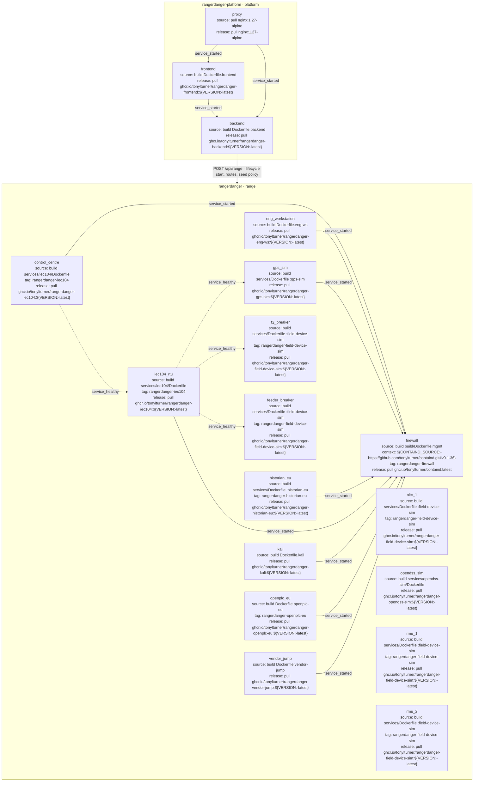
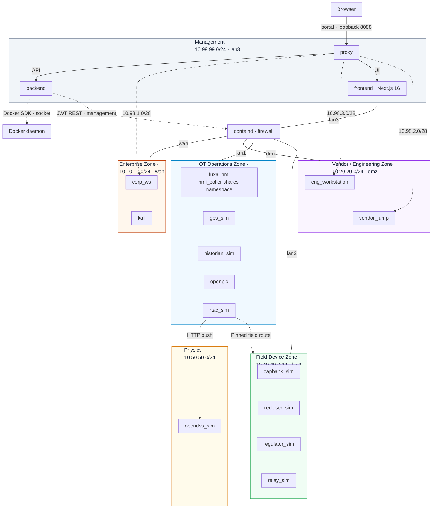
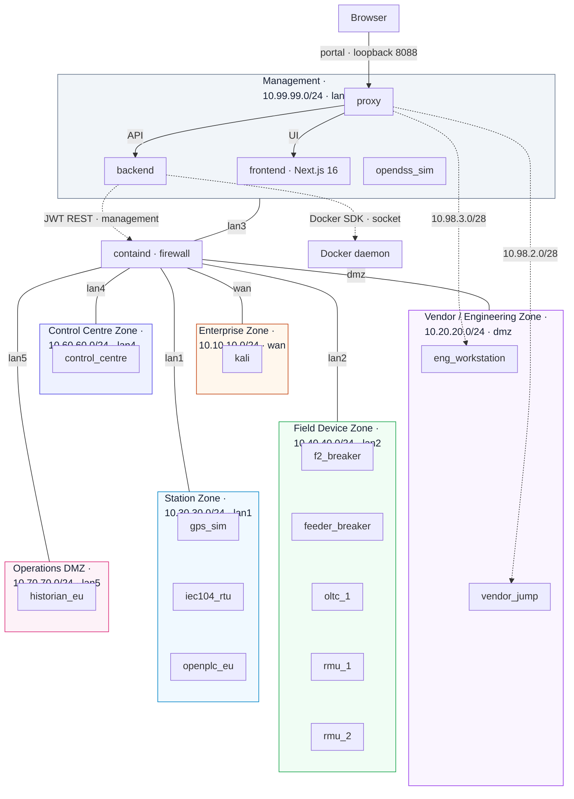
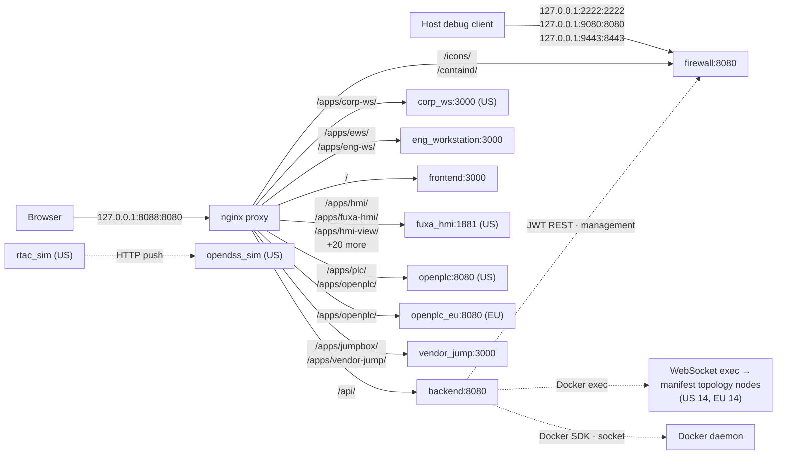

# Docker architecture

How the platform and selected range package are composed: services, image
modes, Docker networks and browser request paths. For the teaching topology
and RTAC routing see [`architecture.md`](architecture.md); for code layout
see [`CONTRIBUTING.md`](../CONTRIBUTING.md).

All six Mermaid views (including the README overview) and both wiring tables
are generated by
[`scripts/generate_architecture.py`](../scripts/generate_architecture.py).
Run `python3 scripts/generate_architecture.py` after changing the inputs;
CI runs `python3 scripts/generate_architecture.py --check` and rejects drift.
The generator reads package-declared topology pointers, manifests, source and
release Compose files, platform/package nginx routes, the frontend version
and the release image inventory. It does not run Docker or contact registries.
Non-declarative logical edges live in the small reviewed
[`architecture/overlay.yml`](architecture/overlay.yml), with repository source
citations. A checker verifies citation paths exist, not that their semantics
remain correct; those edges still require code review.

## Compose stack - services, images, dependencies

Each package runs beside the persistent **platform** (`rangerdanger-platform`:
backend, frontend, proxy). The selected **range** is project `rangerdanger`;
US and EU are alternatives, not simultaneous projects. Root Compose files
own the platform; each package owns `compose.source.yml` and
`compose.release.yml`.

Boxes show **source** build/pull declarations separately from **release**
pulls. A service can declare both `build:` and `image:`: the latter names
the build output in source mode. In particular, source mode builds
`rangerdanger-firewall` from the containd git ref in its context (or the
explicit `CONTAIND_SOURCE` override); release mode pulls containd `latest`.
The diagrams describe image preparation, not a promise that the backend
builds images: lifecycle startup uses prebuilt images.

Dependency arrows point from dependent to prerequisite, and carry the exact
Compose condition. Solid = `service_started`; dashed = `service_healthy`
(or another explicitly named completion condition). These are startup
relationships, **not logical traffic flows**. Namespace links mean one
network namespace, not an additional NIC. The separately cited lifecycle
edge describes backend-managed startup, routes and default policy; there
is no cross-project Compose `depends_on`.

### US package

```mermaid
flowchart TB
    subgraph n_us_platform_9b44174f23["rangerdanger-platform · platform"]
    n_us_compose_backend_498c6eb888["backend<br/>source: build Dockerfile.backend<br/>release: pull ghcr.io/tonylturner/rangerdanger-backend:$#123;VERSION:-latest#125;"]
    n_us_compose_frontend_9a5cb0fe74["frontend<br/>source: build Dockerfile.frontend<br/>release: pull ghcr.io/tonylturner/rangerdanger-frontend:$#123;VERSION:-latest#125;"]
    n_us_compose_proxy_9ad386b7ed["proxy<br/>source: pull nginx:1.27-alpine<br/>release: pull nginx:1.27-alpine"]
    end
    n_us_compose_frontend_9a5cb0fe74 -->|"service_started"| n_us_compose_backend_498c6eb888
    n_us_compose_proxy_9ad386b7ed -->|"service_started"| n_us_compose_backend_498c6eb888
    n_us_compose_proxy_9ad386b7ed -->|"service_started"| n_us_compose_frontend_9a5cb0fe74
    subgraph n_us_range_0321fc2186["rangerdanger · range"]
    n_us_compose_capbank_sim_6f7dab5aef["capbank_sim<br/>source: build services/Dockerfile :capbank-sim<br/>release: pull ghcr.io/tonylturner/rangerdanger-capbank-sim:$#123;VERSION:-latest#125;"]
    n_us_compose_corp_ws_f0398579f9["corp_ws<br/>source: build Dockerfile.corp-ws<br/>release: pull ghcr.io/tonylturner/rangerdanger-corp-ws:$#123;VERSION:-latest#125;"]
    n_us_compose_eng_workstation_56ddebdbe5["eng_workstation<br/>source: build Dockerfile.eng-ws<br/>release: pull ghcr.io/tonylturner/rangerdanger-eng-ws:$#123;VERSION:-latest#125;"]
    n_us_compose_firewall_075662beef["firewall<br/>source: build build/Dockerfile.mgmt<br/>context: $#123;CONTAIND_SOURCE:-https://github.com/tonylturner/containd.git#35;v0.1.36#125;<br/>tag: rangerdanger-firewall<br/>release: pull ghcr.io/tonylturner/containd:latest"]
    n_us_compose_fuxa_hmi_259698b3a3["fuxa_hmi<br/>source: build Dockerfile.fuxa-hmi<br/>tag: rangerdanger-fuxa-hmi<br/>release: pull ghcr.io/tonylturner/rangerdanger-fuxa-hmi:$#123;VERSION:-latest#125;"]
    n_us_compose_gps_sim_f42cfd8c71["gps_sim<br/>source: build services/Dockerfile :gps-sim<br/>release: pull ghcr.io/tonylturner/rangerdanger-gps-sim:$#123;VERSION:-latest#125;"]
    n_us_compose_historian_sim_f4fa42aecb["historian_sim<br/>source: build services/Dockerfile :historian-sim<br/>release: pull ghcr.io/tonylturner/rangerdanger-historian-sim:$#123;VERSION:-latest#125;"]
    n_us_compose_hmi_poller_25adcf9058["hmi_poller<br/>source: pull alpine:3.21<br/>release: pull alpine:3.21"]
    n_us_compose_kali_b891853735["kali<br/>source: build Dockerfile.kali<br/>release: pull ghcr.io/tonylturner/rangerdanger-kali:$#123;VERSION:-latest#125;"]
    n_us_compose_opendss_sim_ab889d201b["opendss_sim<br/>source: build services/opendss-sim/Dockerfile<br/>release: pull ghcr.io/tonylturner/rangerdanger-opendss-sim:$#123;VERSION:-latest#125;"]
    n_us_compose_openplc_9a932f75ee["openplc<br/>source: build Dockerfile.openplc<br/>release: pull ghcr.io/tonylturner/rangerdanger-openplc:$#123;VERSION:-latest#125;"]
    n_us_compose_recloser_sim_b44b66d0ee["recloser_sim<br/>source: build services/Dockerfile :recloser-sim<br/>release: pull ghcr.io/tonylturner/rangerdanger-recloser-sim:$#123;VERSION:-latest#125;"]
    n_us_compose_regulator_sim_258a276a49["regulator_sim<br/>source: build services/Dockerfile :regulator-sim<br/>release: pull ghcr.io/tonylturner/rangerdanger-regulator-sim:$#123;VERSION:-latest#125;"]
    n_us_compose_relay_sim_8b3f5121ef["relay_sim<br/>source: build services/Dockerfile :relay-sim<br/>release: pull ghcr.io/tonylturner/rangerdanger-relay-sim:$#123;VERSION:-latest#125;"]
    n_us_compose_rtac_sim_cea59b9b4b["rtac_sim<br/>source: build services/Dockerfile :rtac-sim<br/>release: pull ghcr.io/tonylturner/rangerdanger-rtac-sim:$#123;VERSION:-latest#125;"]
    n_us_compose_vendor_jump_47c8dd627d["vendor_jump<br/>source: build Dockerfile.vendor-jump<br/>release: pull ghcr.io/tonylturner/rangerdanger-vendor-jump:$#123;VERSION:-latest#125;"]
    end
    n_us_compose_capbank_sim_6f7dab5aef -->|"service_started"| n_us_compose_firewall_075662beef
    n_us_compose_corp_ws_f0398579f9 -->|"service_started"| n_us_compose_firewall_075662beef
    n_us_compose_eng_workstation_56ddebdbe5 -->|"service_started"| n_us_compose_firewall_075662beef
    n_us_compose_fuxa_hmi_259698b3a3 -->|"service_started"| n_us_compose_firewall_075662beef
    n_us_compose_gps_sim_f42cfd8c71 -->|"service_started"| n_us_compose_firewall_075662beef
    n_us_compose_historian_sim_f4fa42aecb -->|"service_started"| n_us_compose_firewall_075662beef
    n_us_compose_historian_sim_f4fa42aecb -->|"service_started"| n_us_compose_rtac_sim_cea59b9b4b
    n_us_compose_hmi_poller_25adcf9058 -->|"service_started"| n_us_compose_fuxa_hmi_259698b3a3
    n_us_compose_hmi_poller_25adcf9058 -->|"service_started"| n_us_compose_rtac_sim_cea59b9b4b
    n_us_compose_hmi_poller_25adcf9058 ---|"shares network namespace"| n_us_compose_fuxa_hmi_259698b3a3
    n_us_compose_kali_b891853735 -->|"service_started"| n_us_compose_firewall_075662beef
    n_us_compose_openplc_9a932f75ee -->|"service_started"| n_us_compose_firewall_075662beef
    n_us_compose_recloser_sim_b44b66d0ee -->|"service_started"| n_us_compose_firewall_075662beef
    n_us_compose_regulator_sim_258a276a49 -->|"service_started"| n_us_compose_firewall_075662beef
    n_us_compose_relay_sim_8b3f5121ef -->|"service_started"| n_us_compose_firewall_075662beef
    n_us_compose_rtac_sim_cea59b9b4b -.->|"service_healthy"| n_us_compose_capbank_sim_6f7dab5aef
    n_us_compose_rtac_sim_cea59b9b4b -->|"service_started"| n_us_compose_firewall_075662beef
    n_us_compose_rtac_sim_cea59b9b4b -.->|"service_healthy"| n_us_compose_opendss_sim_ab889d201b
    n_us_compose_rtac_sim_cea59b9b4b -.->|"service_healthy"| n_us_compose_recloser_sim_b44b66d0ee
    n_us_compose_rtac_sim_cea59b9b4b -.->|"service_healthy"| n_us_compose_regulator_sim_258a276a49
    n_us_compose_rtac_sim_cea59b9b4b -.->|"service_healthy"| n_us_compose_relay_sim_8b3f5121ef
    n_us_compose_vendor_jump_47c8dd627d -->|"service_started"| n_us_compose_firewall_075662beef
    %% source: backend/internal/lifecycle/transition.go:157
    n_us_compose_backend_498c6eb888 -.->|"POST /api/range · lifecycle start, routes, seed policy"| n_us_range_0321fc2186
```

<!-- BEGIN GENERATED: compose-us -->

Release inventory: **20 first-party images**, including **9 shared-service targets**.
amd64-only: `rangerdanger-openplc`, `rangerdanger-openplc-eu`.
Source build bases are not the same inventory as upstream service pulls.
<!-- END GENERATED: compose-us -->

### EU package

<!-- BEGIN GENERATED: compose-eu -->

<!-- END GENERATED: compose-eu -->

Upstream **service pulls** appear in the boxes (for example nginx, containd
in release mode, and the US poller). Build-base images are a different
inventory: see the Dockerfiles and image pin gate, not a count of running
services.

## Docker network wiring

These are zone diagrams, not NIC diagrams: each service appears once in its
primary zone (topology membership first, then its first teaching network,
then management when attached; otherwise its first attached network).
Firewall attachments carry interface labels;
dotted desktop links carry delivery subnets. Shared-network notes cover
secondary management and process/physics membership without device-level
edges. FUXA's label notes its shared poller namespace.

The generated table directly under each diagram contains the complete Compose
wiring: one row per service, one column per network, with `IP · iface` where
Compose pins an interface name. This includes platform networks unused by the
selected range. Colours are authored presentation metadata, not policy.

### US package networks

<!-- BEGIN GENERATED: network-us -->

**Shared-network notes** (secondary NICs are listed in the table):

- `mgmt_net` · `10.99.99.0/24`: out-of-band management; spans Management, OT Operations Zone.
- `physics_net` · `10.50.50.0/24`: no firewall attachment; spans OT Operations Zone, Physics.
<!-- END GENERATED: network-us -->

<!-- BEGIN GENERATED: wiring-us -->
One row per service. Namespace-sharing services have no independent NIC; — means no independent attachment. Cells show IP · interface where pinned.

| Service | desk_corp_net | desk_eng_net | desk_vendor_net | enterprise_net | field_net | mgmt_net | ot_ops_net | physics_net | vendor_net |
| --- | --- | --- | --- | --- | --- | --- | --- | --- | --- |
| backend | — | — | — | — | — | 10.99.99.10 | — | — | — |
| capbank_sim | — | — | — | — | 10.40.40.23 | — | — | — | — |
| corp_ws | 10.98.1.3 | — | — | 10.10.10.10 | — | — | — | — | — |
| eng_workstation | — | 10.98.3.3 | — | — | — | — | — | — | 10.20.20.20 |
| firewall | — | — | — | 10.10.10.2 · wan | 10.40.40.2 · lan2 | 10.99.99.2 · lan3 | 10.30.30.2 · lan1 | — | 10.20.20.2 · dmz |
| frontend | — | — | — | — | — | 10.99.99.11 | — | — | — |
| fuxa_hmi | — | — | — | — | — | 10.99.99.50 | 10.30.30.10 | — | — |
| gps_sim | — | — | — | — | — | — | 10.30.30.50 | — | — |
| historian_sim | — | — | — | — | — | — | 10.30.30.40 | — | — |
| hmi_poller (shares fuxa_hmi namespace) | — | — | — | — | — | — | — | — | — |
| kali | — | — | — | 10.10.10.50 | — | — | — | — | — |
| opendss_sim | — | — | — | — | — | — | — | 10.50.50.20 | — |
| openplc | — | — | — | — | — | 10.99.99.30 | 10.30.30.30 | — | — |
| proxy | 10.98.1.2 | 10.98.3.2 | 10.98.2.2 | — | — | 10.99.99.3 | — | — | — |
| recloser_sim | — | — | — | — | 10.40.40.21 | — | — | — | — |
| regulator_sim | — | — | — | — | 10.40.40.22 | — | — | — | — |
| relay_sim | — | — | — | — | 10.40.40.20 | — | — | — | — |
| rtac_sim | — | — | — | — | 10.40.40.10 | 10.99.99.20 | 10.30.30.20 | 10.50.50.10 | — |
| vendor_jump | — | — | 10.98.2.3 | — | — | — | — | — | 10.20.20.10 |
<!-- END GENERATED: wiring-us -->

The US firewall joins four teaching zones plus management, not physics.
`rtac_sim` joins OT, field, physics and management, but
[`rtac-harden.sh`](../scripts/rtac-harden.sh) replaces its directly connected
field route with one via the OT firewall. See
[Multi-homed RTAC](architecture.md#multi-homed-rtac-with-kernel-pinned-routing).
The `hmi_poller` sidecar shares FUXA's network namespace and has no independent
NIC or terminal node. The L4 source pin enforces; DPI detects and logs.

### EU package networks

<!-- BEGIN GENERATED: network-eu -->

**Shared-network notes** (secondary NICs are listed in the table):

- `mgmt_net` · `10.99.99.0/24`: out-of-band management; spans Control Centre Zone, Field Device Zone, Management, Operations DMZ, Station Zone.
- `process_net` · `10.50.50.0/24`: no firewall attachment; spans Field Device Zone, Management.
<!-- END GENERATED: network-eu -->

<!-- BEGIN GENERATED: wiring-eu -->
One row per service. Namespace-sharing services have no independent NIC; — means no independent attachment. Cells show IP · interface where pinned.

| Service | control_centre_net | desk_corp_net | desk_eng_net | desk_vendor_net | enterprise_net | field_net | mgmt_net | ops_dmz_net | process_net | station_net | vendor_net |
| --- | --- | --- | --- | --- | --- | --- | --- | --- | --- | --- | --- |
| backend | — | — | — | — | — | — | 10.99.99.10 | — | — | — | — |
| control_centre | 10.60.60.20 | — | — | — | — | — | 10.99.99.21 | — | — | — | — |
| eng_workstation | — | — | 10.98.3.3 | — | — | — | — | — | — | — | 10.20.20.20 |
| f2_breaker | — | — | — | — | — | 10.40.40.24 | 10.99.99.28 | — | 10.50.50.34 | — | — |
| feeder_breaker | — | — | — | — | — | 10.40.40.20 | 10.99.99.22 | — | 10.50.50.30 | — | — |
| firewall | 10.60.60.2 · lan4 | — | — | — | 10.10.10.2 · wan | 10.40.40.2 · lan2 | 10.99.99.2 · lan3 | 10.70.70.2 · lan5 | — | 10.30.30.2 · lan1 | 10.20.20.2 · dmz |
| frontend | — | — | — | — | — | — | 10.99.99.11 | — | — | — | — |
| gps_sim | — | — | — | — | — | — | 10.99.99.27 | — | — | 10.30.30.50 | — |
| historian_eu | — | — | — | — | — | — | 10.99.99.40 | 10.70.70.40 | — | — | — |
| iec104_rtu | — | — | — | — | — | — | — | — | — | 10.30.30.20 | — |
| kali | — | — | — | — | 10.10.10.50 | — | — | — | — | — | — |
| oltc_1 | — | — | — | — | — | 10.40.40.23 | 10.99.99.26 | — | 10.50.50.33 | — | — |
| opendss_sim | — | — | — | — | — | — | 10.99.99.23 | — | 10.50.50.20 | — | — |
| openplc_eu | — | — | — | — | — | — | 10.99.99.30 | — | — | 10.30.30.30 | — |
| proxy | — | 10.98.1.2 | 10.98.3.2 | 10.98.2.2 | — | — | 10.99.99.3 | — | — | — | — |
| rmu_1 | — | — | — | — | — | 10.40.40.21 | 10.99.99.24 | — | 10.50.50.31 | — | — |
| rmu_2 | — | — | — | — | — | 10.40.40.22 | 10.99.99.25 | — | 10.50.50.32 | — | — |
| vendor_jump | — | — | — | 10.98.2.3 | — | — | — | — | — | — | 10.20.20.10 |
<!-- END GENERATED: wiring-eu -->

The EU firewall also joins control-centre and operations-DMZ zones. Its
process bridge is internal and has no firewall attachment. Management
remains out of band; same-zone bridge traffic and process/physics traffic
are not universally firewalled.

**Student desktops do not attach to `mgmt_net`.** The proxy reaches US
corporate/vendor/engineering desktops on separate internal delivery bridges
(gateway `.1`, proxy `.2`, desktop `.3`). EU uses vendor and engineering
bridges only; the platform's corporate delivery bridge persists unused.
nginx returns 403 for requests from delivery peers before route selection,
including redirects. Service-name upstream resolution uses Docker DNS;
each upstream shares exactly one network with the proxy. Keep these
boundaries intact: portal rendering alone is not evidence of segmentation.

## How the range wires up - request flow

The portal's normal ingress is `http://localhost:8088`, including containd
at `/containd/`. **Exception:** the firewall also publishes loopback-only
direct ports for instructor/debug use. Those ports are not the reserved
management path and do not promise management reachability under every
policy. The backend reaches containd on `mgmt_net`.

Below, nginx locations collapse into one edge per upstream. Labels show at most
three public prefixes; additional locations (including regex and root API
exceptions) are counted, not printed. US/EU-only upstreams are marked.
Root `/api/` goes to the backend **except for the more specific US FUXA
locations**: `/api/version`, `/api/settings`, `/api/project`,
`/api/projectData`, `/api/device`, `/api/alarmsHistory`, `/api/resources`.
Prefix/regex/exact matching and rewrites still follow nginx semantics;
this graph is a route inventory, not an executable routing simulator.
There is no `/apps/firewall` alias. Password-change locations return 403.
The platform's delivery-peer 403 guard applies before all these locations.

<!-- BEGIN GENERATED: request-flow -->

<!-- END GENERATED: request-flow -->

Terminal selection is restricted to services mapped to topology nodes in
the active package's manifest: solver and sidecar services are not terminal
targets. WebSocket terminal requests pass through the API to Docker exec.
Cross-zone teaching traffic uses the firewall; dependency/identity arrows
in earlier diagrams do not imply protocol traffic.

**Published host ports are loopback-only:** `127.0.0.1:8088` maps to proxy
8080; firewall `127.0.0.1:9080`, `:9443`, `:2222` map to container 8080,
8443 and 2222. There are no other published host ports. The backend
publishes no host port; its Docker network is not "loopback-bound".
See [`SECURITY.md`](../SECURITY.md) before considering external access.

**Critical bind mounts:**

- Backend loads `./lab-definitions:/lab-definitions:ro`; restart it after
  content changes. `${RANGERDANGER_ROOT}:${RANGERDANGER_ROOT}:ro` preserves
  absolute host paths for Compose bind mounts accepted by the Docker daemon.
- Backend mounts `/var/run/docker.sock` for orchestration. Access to the
  unauthenticated backend/terminals is a host-level trust boundary, not a
  sandbox for untrusted users.
- `./data/proxy-routes` is writable at backend `/proxy-routes` and read-only
  at proxy `/etc/nginx/rd-routes`. Lifecycle startup installs the package's
  `nginx.routes.conf`, tests nginx, then reloads; a failed reload restores
  the prior file.
- Firewall state maps to `/data`: US uses `data/firewall`, EU uses
  `data/eu-iec104-substation/firewall`. Workshop reset clears captures and
  removes `users.db`/`sessions.db` as a credential-recovery backstop;
  the firewall must restart to reseed credentials. Preserve pre-upgrade
  backups: see [upgrade guidance](quickstart.md#upgrading-to-v020).
- US OpenPLC mounts `data/openplc` at `/workdir` for a local program
  override. EU OpenPLC has no corresponding host state bind.
- `./proxy/nginx.conf:/etc/nginx/nginx.conf:ro` supplies platform routes
  plus the package route include. Range routes install during a range
  start (`POST /api/range`), not merely by editing the source file.

## Image build and release pipeline

[`.github/release-images.json`](../.github/release-images.json) is the
canonical first-party inventory; the generated count above covers **both
packages**, not only the US services. Releases **build or promote** images
according to the release planner; unchanged image roots can be promoted by
digest rather than rebuilt on every tag. Both OpenPLC variants are
amd64-only; the other inventory entries declare amd64 and arm64.
See [`RELEASING.md`](../RELEASING.md) for tags, buildx, GHCR and setup pulls.
