```mermaid
flowchart TB
    subgraph n_us_sra_substation_platform_0149d934a2["rangerdanger-platform · platform"]
    n_us_sra_substation_compose_backend_f1e75d96e8["backend<br/>source: build Dockerfile.backend<br/>release: pull ghcr.io/tonylturner/rangerdanger-backend:$#123;VERSION:-latest#125;"]
    n_us_sra_substation_compose_frontend_726bf16d0b["frontend<br/>source: build Dockerfile.frontend<br/>release: pull ghcr.io/tonylturner/rangerdanger-frontend:$#123;VERSION:-latest#125;"]
    n_us_sra_substation_compose_proxy_9984e090da["proxy<br/>source: pull nginx:1.27-alpine<br/>release: pull nginx:1.27-alpine"]
    end
    n_us_sra_substation_compose_frontend_726bf16d0b -->|"service_started"| n_us_sra_substation_compose_backend_f1e75d96e8
    n_us_sra_substation_compose_proxy_9984e090da -->|"service_started"| n_us_sra_substation_compose_backend_f1e75d96e8
    n_us_sra_substation_compose_proxy_9984e090da -->|"service_started"| n_us_sra_substation_compose_frontend_726bf16d0b
    subgraph n_us_sra_substation_range_6e815e54f3["rangerdanger · range"]
    n_us_sra_substation_compose_capbank_sim_3ec73b15a1["capbank_sim<br/>source: build services/Dockerfile :capbank-sim<br/>release: pull ghcr.io/tonylturner/rangerdanger-capbank-sim:$#123;VERSION:-latest#125;"]
    n_us_sra_substation_compose_firewall_e19df3dfdb["firewall<br/>source: pull $#123;CONTAIND_IMAGE:-ghcr.io/tonylturner/containd:latest#125;<br/>release: pull ghcr.io/tonylturner/containd:latest"]
    n_us_sra_substation_compose_fuxa_hmi_77446c14c2["fuxa_hmi<br/>source: build Dockerfile.fuxa-hmi<br/>tag: rangerdanger-fuxa-hmi<br/>release: pull ghcr.io/tonylturner/rangerdanger-fuxa-hmi:$#123;VERSION:-latest#125;"]
    n_us_sra_substation_compose_gps_sim_584df7d677["gps_sim<br/>source: build services/Dockerfile :gps-sim<br/>release: pull ghcr.io/tonylturner/rangerdanger-gps-sim:$#123;VERSION:-latest#125;"]
    n_us_sra_substation_compose_historian_sim_29ca8d5438["historian_sim<br/>source: build services/Dockerfile :historian-sim<br/>release: pull ghcr.io/tonylturner/rangerdanger-historian-sim:$#123;VERSION:-latest#125;"]
    n_us_sra_substation_compose_hmi_poller_339d18c15d["hmi_poller<br/>source: pull alpine:3.21<br/>release: pull alpine:3.21"]
    n_us_sra_substation_compose_kali_1f21a2a3b6["kali<br/>source: build Dockerfile.kali<br/>release: pull ghcr.io/tonylturner/rangerdanger-kali:$#123;VERSION:-latest#125;"]
    n_us_sra_substation_compose_opendss_sim_c116fb4df0["opendss_sim<br/>source: build services/opendss-sim/Dockerfile<br/>release: pull ghcr.io/tonylturner/rangerdanger-opendss-sim:$#123;VERSION:-latest#125;"]
    n_us_sra_substation_compose_recloser_sim_8bf7904e8c["recloser_sim<br/>source: build services/Dockerfile :recloser-sim<br/>release: pull ghcr.io/tonylturner/rangerdanger-recloser-sim:$#123;VERSION:-latest#125;"]
    n_us_sra_substation_compose_regulator_sim_87057c27de["regulator_sim<br/>source: build services/Dockerfile :regulator-sim<br/>release: pull ghcr.io/tonylturner/rangerdanger-regulator-sim:$#123;VERSION:-latest#125;"]
    n_us_sra_substation_compose_relay_sim_e9c69ce7d6["relay_sim<br/>source: build services/Dockerfile :relay-sim<br/>release: pull ghcr.io/tonylturner/rangerdanger-relay-sim:$#123;VERSION:-latest#125;"]
    n_us_sra_substation_compose_rtac_sim_ef837b13e9["rtac_sim<br/>source: build services/Dockerfile :rtac-sim<br/>release: pull ghcr.io/tonylturner/rangerdanger-rtac-sim:$#123;VERSION:-latest#125;"]
    n_us_sra_substation_compose_sra_guacamole_906ee8b840["sra_guacamole<br/>source: build Dockerfile.sra-guacamole<br/>release: pull ghcr.io/tonylturner/rangerdanger-sra-guacamole:$#123;VERSION:-latest#125;"]
    n_us_sra_substation_compose_sra_guacd_9af6351b95["sra_guacd<br/>source: build Dockerfile.sra-guacd<br/>release: pull ghcr.io/tonylturner/rangerdanger-sra-guacd:$#123;VERSION:-latest#125;"]
    n_us_sra_substation_compose_sra_keycloak_b9d3697b0b["sra_keycloak<br/>source: build Dockerfile.sra-keycloak<br/>release: pull ghcr.io/tonylturner/rangerdanger-sra-keycloak:$#123;VERSION:-latest#125;"]
    n_us_sra_substation_compose_sra_postgres_9dd1316413["sra_postgres<br/>source: build Dockerfile.sra-postgres<br/>release: pull ghcr.io/tonylturner/rangerdanger-sra-postgres:$#123;VERSION:-latest#125;"]
    n_us_sra_substation_compose_sra_ziti_controller_955e68a8ea["sra_ziti_controller<br/>source: build Dockerfile.sra-ziti-controller<br/>release: pull ghcr.io/tonylturner/rangerdanger-sra-ziti-controller:$#123;VERSION:-latest#125;"]
    n_us_sra_substation_compose_sra_ziti_host_3a3aa1d78c["sra_ziti_host<br/>source: build Dockerfile.sra-ziti-host<br/>release: pull ghcr.io/tonylturner/rangerdanger-sra-ziti-host:$#123;VERSION:-latest#125;"]
    n_us_sra_substation_compose_sra_ziti_router_8f0b40ff00["sra_ziti_router<br/>source: build Dockerfile.sra-ziti-router<br/>release: pull ghcr.io/tonylturner/rangerdanger-sra-ziti-router:$#123;VERSION:-latest#125;"]
    n_us_sra_substation_compose_vendor_jump_fa8d254792["vendor_jump<br/>source: build Dockerfile.vendor-jump<br/>release: pull ghcr.io/tonylturner/rangerdanger-vendor-jump:$#123;VERSION:-latest#125;"]
    end
    n_us_sra_substation_compose_capbank_sim_3ec73b15a1 -->|"service_started"| n_us_sra_substation_compose_firewall_e19df3dfdb
    n_us_sra_substation_compose_fuxa_hmi_77446c14c2 -->|"service_started"| n_us_sra_substation_compose_firewall_e19df3dfdb
    n_us_sra_substation_compose_gps_sim_584df7d677 -->|"service_started"| n_us_sra_substation_compose_firewall_e19df3dfdb
    n_us_sra_substation_compose_historian_sim_29ca8d5438 -->|"service_started"| n_us_sra_substation_compose_firewall_e19df3dfdb
    n_us_sra_substation_compose_historian_sim_29ca8d5438 -->|"service_started"| n_us_sra_substation_compose_rtac_sim_ef837b13e9
    n_us_sra_substation_compose_hmi_poller_339d18c15d -->|"service_started"| n_us_sra_substation_compose_fuxa_hmi_77446c14c2
    n_us_sra_substation_compose_hmi_poller_339d18c15d -->|"service_started"| n_us_sra_substation_compose_rtac_sim_ef837b13e9
    n_us_sra_substation_compose_hmi_poller_339d18c15d ---|"shares network namespace"| n_us_sra_substation_compose_fuxa_hmi_77446c14c2
    n_us_sra_substation_compose_kali_1f21a2a3b6 -->|"service_started"| n_us_sra_substation_compose_firewall_e19df3dfdb
    n_us_sra_substation_compose_recloser_sim_8bf7904e8c -->|"service_started"| n_us_sra_substation_compose_firewall_e19df3dfdb
    n_us_sra_substation_compose_regulator_sim_87057c27de -->|"service_started"| n_us_sra_substation_compose_firewall_e19df3dfdb
    n_us_sra_substation_compose_relay_sim_e9c69ce7d6 -->|"service_started"| n_us_sra_substation_compose_firewall_e19df3dfdb
    n_us_sra_substation_compose_rtac_sim_ef837b13e9 -.->|"service_healthy"| n_us_sra_substation_compose_capbank_sim_3ec73b15a1
    n_us_sra_substation_compose_rtac_sim_ef837b13e9 -->|"service_started"| n_us_sra_substation_compose_firewall_e19df3dfdb
    n_us_sra_substation_compose_rtac_sim_ef837b13e9 -.->|"service_healthy"| n_us_sra_substation_compose_opendss_sim_c116fb4df0
    n_us_sra_substation_compose_rtac_sim_ef837b13e9 -.->|"service_healthy"| n_us_sra_substation_compose_recloser_sim_8bf7904e8c
    n_us_sra_substation_compose_rtac_sim_ef837b13e9 -.->|"service_healthy"| n_us_sra_substation_compose_regulator_sim_87057c27de
    n_us_sra_substation_compose_rtac_sim_ef837b13e9 -.->|"service_healthy"| n_us_sra_substation_compose_relay_sim_e9c69ce7d6
    n_us_sra_substation_compose_sra_guacamole_906ee8b840 -.->|"service_healthy"| n_us_sra_substation_compose_sra_guacd_9af6351b95
    n_us_sra_substation_compose_sra_guacamole_906ee8b840 -.->|"service_healthy"| n_us_sra_substation_compose_sra_keycloak_b9d3697b0b
    n_us_sra_substation_compose_sra_guacamole_906ee8b840 -.->|"service_healthy"| n_us_sra_substation_compose_sra_postgres_9dd1316413
    n_us_sra_substation_compose_sra_guacd_9af6351b95 -.->|"service_healthy"| n_us_sra_substation_compose_sra_ziti_router_8f0b40ff00
    n_us_sra_substation_compose_sra_ziti_host_3a3aa1d78c -.->|"service_healthy"| n_us_sra_substation_compose_sra_ziti_controller_955e68a8ea
    n_us_sra_substation_compose_sra_ziti_router_8f0b40ff00 -.->|"service_healthy"| n_us_sra_substation_compose_sra_ziti_controller_955e68a8ea
    n_us_sra_substation_compose_vendor_jump_fa8d254792 -->|"service_started"| n_us_sra_substation_compose_firewall_e19df3dfdb
    %% source: backend/internal/lifecycle/transition.go:157
    n_us_sra_substation_compose_backend_f1e75d96e8 -.->|"POST /api/range · lifecycle start, routes, seed policy"| n_us_sra_substation_range_6e815e54f3
```

<!-- BEGIN GENERATED: compose-us-sra-substation -->

<!-- END GENERATED: compose-us-sra-substation -->

<!-- BEGIN GENERATED: network-us-sra-substation -->

```mermaid
%%{init: {"flowchart": {"nodeSpacing": 22, "rankSpacing": 45, "padding": 10}}}%%
flowchart TB
    subgraph n_us_sra_substation_network_zone_mgmt_net_9c0a50d713["Management ·<br/>10.99.99.0/24 · lan3"]
    direction TB
    n_us_sra_substation_network_backend_e03fdb209c["backend"]
    n_us_sra_substation_network_frontend_2e633ee947["frontend · Next.js 16"]
    n_us_sra_substation_network_proxy_346f9ba4ae["proxy"]
    end
    subgraph n_us_sra_substation_network_zone_field_net_8fb7a65b1e["Field Device Zone ·<br/>10.40.40.0/24 · lan2"]
    direction TB
    n_us_sra_substation_network_capbank_sim_b9de93e13c["capbank_sim"]
    n_us_sra_substation_network_recloser_sim_a81b66f317["recloser_sim"]
    n_us_sra_substation_network_regulator_sim_d2be4da447["regulator_sim"]
    n_us_sra_substation_network_relay_sim_4e45f7a1d2["relay_sim"]
    n_us_sra_substation_network_capbank_sim_b9de93e13c ~~~ n_us_sra_substation_network_recloser_sim_a81b66f317
    n_us_sra_substation_network_recloser_sim_a81b66f317 ~~~ n_us_sra_substation_network_regulator_sim_d2be4da447
    n_us_sra_substation_network_regulator_sim_d2be4da447 ~~~ n_us_sra_substation_network_relay_sim_4e45f7a1d2
    end
    subgraph n_us_sra_substation_network_zone_ot_ops_net_0ce9f0b8ff["OT Operations Zone ·<br/>10.30.30.0/24 · lan1"]
    direction TB
    n_us_sra_substation_network_fuxa_hmi_06212fdd0e["fuxa_hmi<br/>hmi_poller shares namespace"]
    n_us_sra_substation_network_gps_sim_2bc069f79f["gps_sim"]
    n_us_sra_substation_network_historian_sim_d4be983a26["historian_sim"]
    n_us_sra_substation_network_rtac_sim_5b03781751["rtac_sim"]
    n_us_sra_substation_network_sra_ziti_host_a10e6aa266["sra_ziti_host"]
    n_us_sra_substation_network_fuxa_hmi_06212fdd0e ~~~ n_us_sra_substation_network_gps_sim_2bc069f79f
    n_us_sra_substation_network_gps_sim_2bc069f79f ~~~ n_us_sra_substation_network_historian_sim_d4be983a26
    n_us_sra_substation_network_historian_sim_d4be983a26 ~~~ n_us_sra_substation_network_rtac_sim_5b03781751
    n_us_sra_substation_network_rtac_sim_5b03781751 ~~~ n_us_sra_substation_network_sra_ziti_host_a10e6aa266
    end
    subgraph n_us_sra_substation_network_zone_enterprise_net_a2d52dc5fe["Enterprise Zone ·<br/>10.10.10.0/24 · wan"]
    direction TB
    n_us_sra_substation_network_kali_ce952aa64b["kali"]
    end
    subgraph n_us_sra_substation_network_zone_physics_net_9e601702c1["Physics ·<br/>10.50.50.0/24"]
    direction TB
    n_us_sra_substation_network_opendss_sim_6a8ed48816["opendss_sim"]
    end
    subgraph n_us_sra_substation_network_zone_sra_dmz_net_4e054e6f80["Secure Remote Access DMZ ·<br/>10.25.25.0/24 · lan4"]
    direction TB
    n_us_sra_substation_network_sra_guacamole_06021e147e["sra_guacamole"]
    n_us_sra_substation_network_sra_guacd_61db0c334d["sra_guacd"]
    n_us_sra_substation_network_sra_keycloak_203122c4df["sra_keycloak"]
    n_us_sra_substation_network_sra_postgres_85135e922c["sra_postgres"]
    n_us_sra_substation_network_sra_ziti_controller_0e0c49077a["sra_ziti_controller"]
    n_us_sra_substation_network_sra_ziti_router_6adbd9c2a3["sra_ziti_router"]
    n_us_sra_substation_network_sra_guacamole_06021e147e ~~~ n_us_sra_substation_network_sra_guacd_61db0c334d
    n_us_sra_substation_network_sra_guacd_61db0c334d ~~~ n_us_sra_substation_network_sra_keycloak_203122c4df
    n_us_sra_substation_network_sra_keycloak_203122c4df ~~~ n_us_sra_substation_network_sra_postgres_85135e922c
    n_us_sra_substation_network_sra_postgres_85135e922c ~~~ n_us_sra_substation_network_sra_ziti_controller_0e0c49077a
    n_us_sra_substation_network_sra_ziti_controller_0e0c49077a ~~~ n_us_sra_substation_network_sra_ziti_router_6adbd9c2a3
    end
    subgraph n_us_sra_substation_network_zone_vendor_net_3a8ac2f3a1["Vendor Zone ·<br/>10.20.20.0/24 · dmz"]
    direction TB
    n_us_sra_substation_network_vendor_jump_6af2299a9f["vendor_jump"]
    end
    n_us_sra_substation_network_firewall_07fe415524["containd · firewall"]
    n_us_sra_substation_network_dockerd_5a287de405["Docker daemon"]
    n_us_sra_substation_network_browser_71e18cbcd1["Browser"]
    n_us_sra_substation_network_browser_71e18cbcd1 -->|"portal · loopback 8088"| n_us_sra_substation_network_proxy_346f9ba4ae
    n_us_sra_substation_network_zone_mgmt_net_9c0a50d713 ---|"lan3"| n_us_sra_substation_network_firewall_07fe415524
    n_us_sra_substation_network_firewall_07fe415524 ---|"wan"| n_us_sra_substation_network_zone_enterprise_net_a2d52dc5fe
    n_us_sra_substation_network_firewall_07fe415524 ---|"dmz"| n_us_sra_substation_network_zone_vendor_net_3a8ac2f3a1
    n_us_sra_substation_network_firewall_07fe415524 ---|"lan1"| n_us_sra_substation_network_zone_ot_ops_net_0ce9f0b8ff
    n_us_sra_substation_network_firewall_07fe415524 ---|"lan2"| n_us_sra_substation_network_zone_field_net_8fb7a65b1e
    n_us_sra_substation_network_firewall_07fe415524 ---|"lan4"| n_us_sra_substation_network_zone_sra_dmz_net_4e054e6f80
    n_us_sra_substation_network_proxy_346f9ba4ae -->|"API"| n_us_sra_substation_network_backend_e03fdb209c
    n_us_sra_substation_network_proxy_346f9ba4ae -->|"UI"| n_us_sra_substation_network_frontend_2e633ee947
    n_us_sra_substation_network_proxy_346f9ba4ae -.->|"10.98.2.0/28"| n_us_sra_substation_network_vendor_jump_6af2299a9f
    %% source: backend/internal/orchestrator/orchestrator.go:New
    n_us_sra_substation_network_backend_e03fdb209c -.->|"Docker SDK · socket"| n_us_sra_substation_network_dockerd_5a287de405
    %% source: backend/internal/containd/client.go:send
    n_us_sra_substation_network_backend_e03fdb209c -.->|"JWT REST · management"| n_us_sra_substation_network_firewall_07fe415524
    %% source: scripts/rtac-harden.sh:93
    n_us_sra_substation_network_rtac_sim_5b03781751 -.->|"Pinned field route"| n_us_sra_substation_network_zone_field_net_8fb7a65b1e
    %% source: services/rtac-sim/main.go:132
    n_us_sra_substation_network_rtac_sim_5b03781751 -.->|"HTTP push"| n_us_sra_substation_network_opendss_sim_6a8ed48816
    style n_us_sra_substation_network_zone_mgmt_net_9c0a50d713 fill:#f1f5f9,stroke:#64748b,color:#172033
    style n_us_sra_substation_network_zone_field_net_8fb7a65b1e fill:#f0fdf4,stroke:#16a34a,color:#172033
    style n_us_sra_substation_network_zone_ot_ops_net_0ce9f0b8ff fill:#f0f9ff,stroke:#0284c7,color:#172033
    style n_us_sra_substation_network_zone_enterprise_net_a2d52dc5fe fill:#fff7ed,stroke:#c2410c,color:#172033
    style n_us_sra_substation_network_zone_physics_net_9e601702c1 fill:#fffbeb,stroke:#d97706,color:#172033
    style n_us_sra_substation_network_zone_sra_dmz_net_4e054e6f80 fill:#fdf2f8,stroke:#db2777,color:#172033
    style n_us_sra_substation_network_zone_vendor_net_3a8ac2f3a1 fill:#faf5ff,stroke:#9333ea,color:#172033
```

**Shared-network notes** (secondary NICs are listed in the table):

- `mgmt_net` · `10.99.99.0/24`: out-of-band management; spans Management, OT Operations Zone.
- `physics_net` · `10.50.50.0/24`: no firewall attachment; spans OT Operations Zone, Physics.
<!-- END GENERATED: network-us-sra-substation -->

<!-- BEGIN GENERATED: wiring-us-sra-substation -->
One row per service. Namespace-sharing services have no independent NIC; — means no independent attachment. Cells show IP · interface where pinned.

| Service | desk_corp_net | desk_eng_net | desk_vendor_net | enterprise_net | field_net | mgmt_net | ot_ops_net | physics_net | sra_dmz_net | vendor_net |
| --- | --- | --- | --- | --- | --- | --- | --- | --- | --- | --- |
| backend | — | — | — | — | — | 10.99.99.10 | — | — | — | — |
| capbank_sim | — | — | — | — | 10.40.40.23 | — | — | — | — | — |
| firewall | — | — | — | 10.10.10.2 · wan | 10.40.40.2 · lan2 | 10.99.99.2 · lan3 | 10.30.30.2 · lan1 | — | 10.25.25.2 · lan4 | 10.20.20.2 · dmz |
| frontend | — | — | — | — | — | 10.99.99.11 | — | — | — | — |
| fuxa_hmi | — | — | — | — | — | 10.99.99.50 | 10.30.30.10 | — | — | — |
| gps_sim | — | — | — | — | — | — | 10.30.30.50 | — | — | — |
| historian_sim | — | — | — | — | — | — | 10.30.30.40 | — | — | — |
| hmi_poller (shares fuxa_hmi namespace) | — | — | — | — | — | — | — | — | — | — |
| kali | — | — | — | 10.10.10.50 | — | — | — | — | — | — |
| opendss_sim | — | — | — | — | — | — | — | 10.50.50.20 | — | — |
| proxy | 10.98.1.2 | 10.98.3.2 | 10.98.2.2 | — | — | 10.99.99.3 | — | — | — | — |
| recloser_sim | — | — | — | — | 10.40.40.21 | — | — | — | — | — |
| regulator_sim | — | — | — | — | 10.40.40.22 | — | — | — | — | — |
| relay_sim | — | — | — | — | 10.40.40.20 | — | — | — | — | — |
| rtac_sim | — | — | — | — | 10.40.40.10 | 10.99.99.20 | 10.30.30.20 | 10.50.50.10 | — | — |
| sra_guacamole | — | — | — | — | — | — | — | — | 10.25.25.20 | — |
| sra_guacd | — | — | — | — | — | — | — | — | 10.25.25.30 | — |
| sra_keycloak | — | — | — | — | — | — | — | — | 10.25.25.10 | — |
| sra_postgres | — | — | — | — | — | — | — | — | 10.25.25.31 | — |
| sra_ziti_controller | — | — | — | — | — | — | — | — | 10.25.25.40 | — |
| sra_ziti_host | — | — | — | — | — | — | 10.30.30.60 | — | — | — |
| sra_ziti_router | — | — | — | — | — | — | — | — | 10.25.25.50 | — |
| vendor_jump | — | — | 10.98.2.3 | — | — | — | — | — | — | 10.20.20.10 |
<!-- END GENERATED: wiring-us-sra-substation -->
